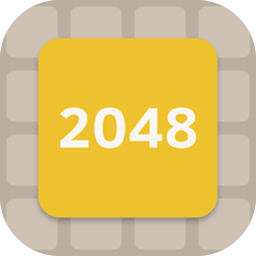
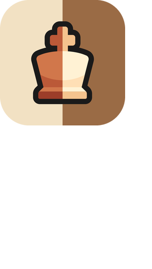

<h1 align="center">Xin chào, mình là Vũ Bảo Châu 👋</h1>
<h3 align="center">Flutter Developer · Hồ Chí Minh City 🇻🇳</h3>

  

---

### 🧑‍💻 About Me

- 📱 **Flutter developer** – mobile is where I'm most confident
- 🧱 Use **Bloc** for state management and care about **clean, maintainable code**
- 🌐 Work with **REST APIs** using **Dio** (interceptors, error handling, token refresh…)
- 🔥 Hands-on with **Firebase** and its ecosystem (Auth, Firestore, FCM, Crashlytics…)
- 🗺️ Integrated **Google Maps** and shipped apps to **App Store / Google Play**, automating releases with **Fastlane**
- 🌱 Currently teaching myself **Node.js** to build backends
- ☕ Have written some CRUD APIs with **Java Spring Boot** in company projects
- 🎓 Graduated from **University of Information Technology (UIT – VNU-HCM)**

### 🛠️ Tech Stack

**Mobile** – my main focus

**Backend** – learning

**Tools**

### 🚀 Featured Projects

<table>
  <tr>
    <td width="50%" valign="top">
      
      
      <a href="https://github.com/vubaochau-coder/sms_navigator"><b>SMS Navigator</b></a> 
      Flutter app that forwards SMS/OTP from the SIM phone to multiple devices with end-to-end encryption.  
      
      
    </td>
    <td width="50%" valign="top">
      
      
      <a href="https://github.com/vubaochau-coder/sms_navigator_server"><b>SMS Navigator Server</b></a> 
      End-to-end encrypted SMS/OTP relay server for SMS Navigator. Holds no keys and cannot read messages.  
      
      
    </td>
  </tr>
  <tr>
    <td width="50%" valign="top">
      
      
      <a href="https://github.com/vubaochau-coder/nonogram"><b>Pixel Nonogram</b></a> 
      Pixel Nonogram – a Flutter picture-logic puzzle game with 1,000+ pixel-art levels, hints, daily check-in and a smooth solve animation.  
      
      
    </td>
    <td width="50%" valign="top">
      
      
      <a href="https://github.com/vubaochau-coder/game-2048"><b>2048</b></a> 
      2048 sliding tile puzzle built with Flutter &amp; BLoC. Auto-play AI (expectimax), saves your game in progress and best score…  
      
      
    </td>
  </tr>
  <tr>
    <td width="50%" valign="top">
      
      
      <a href="https://github.com/vubaochau-coder/chess"><b>Chess</b></a> 
      Chess game for Android built with Flutter. Play against a custom Dart AI (3 levels, runs in an Isolate) or pass-and-play…  
      
      
    </td>
  </tr>
</table>

### 📊 GitHub Stats

  <picture>
    <source media="(prefers-color-scheme: dark)" srcset="https://github-readme-stats.vercel.app/api?username=vubaochau-coder&show_icons=true&theme=tokyonight&hide_border=true" />
    
  </picture>
  <picture>
    <source media="(prefers-color-scheme: dark)" srcset="https://github-readme-stats.vercel.app/api/top-langs/?username=vubaochau-coder&layout=compact&theme=tokyonight&hide_border=true" />
    
  </picture>

  <picture>
    <source media="(prefers-color-scheme: dark)" srcset="https://streak-stats.demolab.com?user=vubaochau-coder&theme=tokyonight&hide_border=true" />
    
  </picture>

<!-- Generated daily by .github/workflows/snake.yml into the "output" branch -->

  <picture>
    <source media="(prefers-color-scheme: dark)" srcset="https://raw.githubusercontent.com/vubaochau-coder/vubaochau-coder/output/github-snake-dark.svg" />
    
  </picture>

### 📫 Connect With Me

  
  
  

  

<i>⭐ Thanks for visiting — have a great day! ⭐</i>

